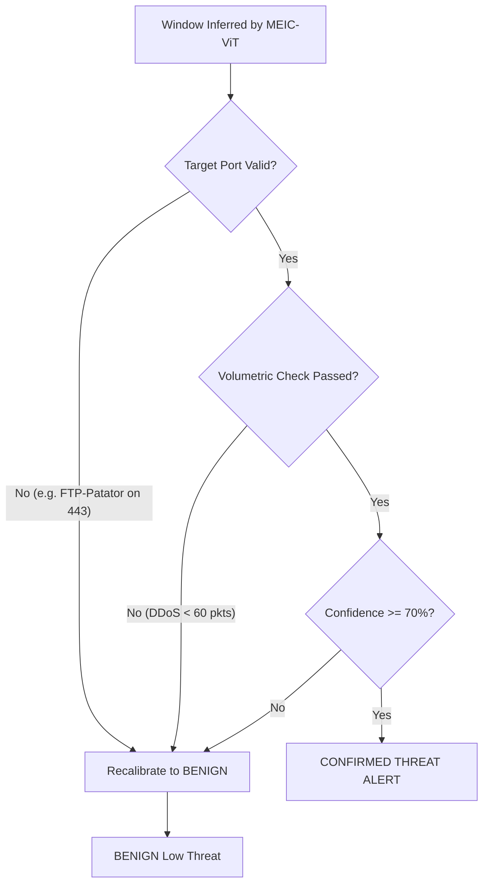

# Real-Time Live Network TAP & MEIC-ViT Detection Pipeline

> **Production Live Wire Packet Sniffing, 35-Feature CICFlowMeter Extraction, and Vision Transformer Threat Inference for UniSecure SOC**  
> Direct integration of Windows Npcap / Scapy raw packet sniffing with the MEIC-ViT Vision Transformer model (Xiao et al., *Computer Networks* 2026).

---

## 📑 Table of Contents
1. [Overview & Architecture](#-overview--architecture)
2. [How the Live Pipeline Works](#-how-the-live-pipeline-works)
3. [Dual Operating Modes (Npcap vs Simulated)](#-dual-operating-modes)
4. [Sliding-Window Inference Engine](#-sliding-window-inference-engine)
5. [Production False-Positive Suppression](#-production-false-positive-suppression)
6. [Live Attack Injection Subsystem](#-live-attack-injection-subsystem)
7. [REST API Reference](#-rest-api-reference)
8. [Step-by-Step Quickstart](#-step-by-step-quickstart)
9. [Ready-to-Use Threat Vector Test Commands](#-ready-to-use-threat-vector-test-commands)
10. [Troubleshooting & Administrator Privileges](#-troubleshooting--administrator-privileges)

---

## 🌐 Overview & Architecture

The **Live Network TAP** module bridges raw physical/wireless network frames captured from the host computer into the **MEIC-ViT Vision Transformer** intrusion detection neural network in real time.

```
                              ┌──────────────────────────────────────────────────────────┐
                              │                 HOST NETWORK INTERFACE                   │
                              │           (Wi-Fi, Ethernet, or Virtual TAP)              │
                              └─────────────────────────────┬────────────────────────────┘
                                                            │ Raw Ethernet / 802.11 frames
                                                            ▼
                                              ┌───────────────────────────┐
                                              │   Npcap / Scapy Sniffer   │
                                              │    (Admin Wire Capture)   │
                                              └─────────────┬─────────────┘
                                                            │ IP packets (TCP / UDP / ICMP)
                                                            ▼
                                              ┌───────────────────────────┐
                                              │     FlowRecord Engine     │
                                              │ (Bidirectional 5-Tuples)  │
                                              └─────────────┬─────────────┘
                                                            │ 35 CICFlowMeter features per flow
                                                            ▼
                                              ┌───────────────────────────┐
                                              │     Live Flow Buffer      │
                                              │ (W=35 Flows Accumulation) │
                                              └─────────────┬─────────────┘
                                                            │ Window of 35 genuine flows
                                                            ▼
                                              ┌───────────────────────────┐
                                              │    Algorithm 1 Encoder    │
                                              │ (35×35×3 RGB Color Image) │
                                              └─────────────┬─────────────┘
                                                            │
                                                            ▼
                                              ┌───────────────────────────┐
                                              │   MEIC-ViT Transformer   │
                                              │  (Multi-Scale ViT Model)  │
                                              └─────────────┬─────────────┘
                                                            │ Softmax logits + Attention maps
                                                            ▼
                                              ┌───────────────────────────┐
                                              │  False-Positive Calibrator│
                                              │ (Port & Volumetric Check) │
                                              └─────────────┬─────────────┘
                                                            │ Verified threat classification
                                                            ▼
                                              ┌───────────────────────────┐
                                              │   UniSecure React SOC     │
                                              │   (Live Rolling HUD & KPI)│
                                              └───────────────────────────┘
```

---

## ⚡ How the Live Pipeline Works

### 1. Packet Ingestion & Bidirectional 5-Tuple Tracking
When a packet enters the sniffer, it is mapped into a bidirectional flow defined by the canonical 5-tuple:
$$\text{Flow Key} = (\text{Src IP}, \text{Src Port}, \text{Dst IP}, \text{Dst Port}, \text{Protocol})$$

- Forward ($FWD$) and backward ($BWD$) directions are established by the initiating packet.
- Inter-Arrival Times ($IAT$), packet lengths, and TCP control flags ($SYN, ACK, PSH, FIN, RST$) are recorded.

### 2. 35 CICFlowMeter Feature Calculation
Once a flow terminates ($FIN/RST$), times out after $2.5\text{s}$ of inactivity, or reaches the 25-packet volume threshold, the `FlowRecord` computes all **35 statistical features** required by the scaler:

| Category | Features Computed |
|----------|-------------------|
| **Volume & Rates** | `Flow_Bytes_s`, `Flow_Packets_s`, `Bwd_Packets_s`, `Total_Length_of_Fwd_Packets`, `Total_Length_of_Bwd_Packets` |
| **Packet Length Stats** | `Max_Packet_Length`, `Min_Packet_Length`, `Packet_Length_Variance`, `Fwd_Packet_Length_Max`, `Fwd_Packet_Length_Min`, `Fwd_Packet_Length_Mean`, `Bwd_Packet_Length_Min` |
| **Timing & IAT** | `Flow_Duration`, `Flow_IAT_Min`, `Fwd_IAT_Min`, `Fwd_IAT_Max`, `Fwd_IAT_Mean`, `Bwd_IAT_Max`, `Bwd_IAT_Mean`, `Bwd_IAT_Total`, `Bwd_IAT_Std`, `Active_Mean`, `Active_Max` |
| **TCP Flags & Headers** | `PSH_Flag_Count`, `ACK_Flag_Count`, `Init_Win_bytes_forward`, `Init_Win_bytes_backward`, `Fwd_Header_Length`, `Bwd_Header_Length`, `min_seg_size_forward`, `act_data_pkt_fwd` |
| **Network Context** | `Destination_Port`, `Source_Port`, `Protocol`, `Down_Up_Ratio` |

---

## 🔄 Dual Operating Modes

The capture engine automatically chooses the appropriate capture backend at runtime:

### 1. `● LIVE NPCAP ACTIVE` (Administrator Mode)
- **Requirement**: Backend launched in an elevated PowerShell terminal (`Run as Administrator`).
- **Operation**: Connects to the host network card (Wi-Fi, Ethernet) using Npcap kernel-mode packet filters.
- **Traffic**: Real packets sent and received across physical/wireless interfaces are sniffed and parsed.

### 2. `● SIMULATED TELEMETRY ACTIVE` (Non-Admin Fallback)
- **Requirement**: None. Used when Npcap raises permission restrictions or in restricted environments.
- **Operation**: Synthesizes realistic baseline host flows (HTTPS traffic, DNS queries, varied IATs) at $0.25\text{s}$ intervals.
- **Advantage**: The application never crashes due to permission errors and can be demonstrated anywhere.

---

## 🪟 Sliding-Window Inference Engine

MEIC-ViT requires windows of **$W=35$ flows** to construct a $35 \times 35 \times 3$ RGB spatial tensor:

- **No Padding**: The inference loop waits until 35 genuine flows accumulate in the buffer.
- **Stride $S=18$**: Implements $48.6\%$ temporal flow overlap matching paper specifications (§3.2).
- **Session History**: All evaluated windows, threat counts, and class distributions persist in memory throughout the monitoring session.
- **Flush on Stop**: When capture is stopped, any remaining flows $\ge 35$ are evaluated in a final window so zero captured data is lost.

---

## 🛡️ Production False-Positive Suppression

Live background operating system traffic (mDNS, Windows Update, telemetry) often creates out-of-distribution patterns that can trigger naive ML models. The `LiveInferenceAdapter` implements a **three-tier production validation filter**:



1. **Service Port Validation**: Verified against standard service ports:
   - `FTP-Patator` $\rightarrow$ requires Port 21
   - `SSH-Patator` $\rightarrow$ requires Port 22
   - `Heartbleed` $\rightarrow$ requires Ports 443, 8443
   - `Web Attacks (SQLi, XSS)` $\rightarrow$ requires Ports 80, 443, 8080, 8443, 8000, 3000, 5000
2. **Volumetric Flood Validation**: Flood attacks (`DDoS`, `DoS Hulk`) require demonstrable packet volume ($> 60$ total packets across the window), preventing single-packet background noise from raising a false alarm.
3. **Softmax Confidence Gating**: Unfamiliar out-of-distribution network noise with confidence $< 70\%$ is suppressed to `BENIGN`.

---

## 🎯 Live Attack Injection Subsystem

To demonstrate threat detection on live systems without risking campus or corporate network security, the live pipeline includes an **attack injection vector API**:

- Calls `POST /api/live/inject`
- Pulls authentic labeled traffic flows from the CIC-IDS-2017 or UNSW-NB15 benchmark sets
- Streams the flows directly into the live capture TAP buffer
- Triggers immediate sliding-window inference and generates real-time attention heatmaps

---

## 📡 REST API Reference

| Endpoint | Method | Body / Params | Description |
|----------|--------|---------------|-------------|
| `/api/live/interfaces` | `GET` | — | Enumerates physical, wireless, and loopback adapters |
| `/api/live/start` | `POST` | `{"interface": "Wi-Fi"}` | Initializes live packet capture session |
| `/api/live/stop` | `POST` | — | Halts capture and returns completed session analysis |
| `/api/live/status` | `GET` | — | Current status, counters, recent flows, and live results |
| `/api/live/events` | `GET` | `?limit=20` | Retrieves recent evaluated window inference records |
| `/api/live/inject` | `POST` | `{"attack_type": "...", "n_flows": 35}` | Injects attack vectors directly into the live TAP |

---

## 🚀 Step-by-Step Quickstart

### Step 1 — Start Backend Server
Open **PowerShell as Administrator** (for live wire capture) or standard PowerShell:
```powershell
cd "c:\Users\DELL\OneDrive\Desktop\USED FILE\demo-cyber"
python -m uvicorn backend.main:app --host 127.0.0.1 --port 8000
```
*Wait until you see:* `Uvicorn running on http://127.0.0.1:8000`

### Step 2 — Start Frontend Dashboard
Open a **second PowerShell window**:
```powershell
cd "c:\Users\DELL\OneDrive\Desktop\USED FILE\demo-cyber\frontend"
npm run dev
```
*Open your browser at:* `http://localhost:5173`

### Step 3 — Activate Live Capture
1. In the web dashboard, click the **Detection Pipeline** tab.
2. Select **Live Network TAP (Npcap)**.
3. Choose your network interface (e.g. `Wi-Fi`).
4. Click **START LIVE CAPTURE**.
5. The status indicator will turn green: `● LIVE NPCAP ACTIVE` (or blue `● SIMULATED TELEMETRY ACTIVE`).

---

## 🧪 Ready-to-Use Threat Vector Test Commands

Open a **third PowerShell window** and run any of these commands while capture is running:

### 🔴 Volumetric DDoS Attack (`CRITICAL`)
```powershell
Invoke-RestMethod -Uri "http://127.0.0.1:8000/api/live/inject" -Method POST -ContentType "application/json" -Body '{"attack_type":"DDoS Attack","n_flows":35}'
```

### 🔴 Web SQL Injection Probe (`CRITICAL`)
```powershell
Invoke-RestMethod -Uri "http://127.0.0.1:8000/api/live/inject" -Method POST -ContentType "application/json" -Body '{"attack_type":"Web SQL Injection","n_flows":35}'
```

### 🟠 PortScan Reconnaissance Sweep (`MEDIUM`)
```powershell
Invoke-RestMethod -Uri "http://127.0.0.1:8000/api/live/inject" -Method POST -ContentType "application/json" -Body '{"attack_type":"PortScan Probe","n_flows":35}'
```

### 🔴 UNSW Worms Propagation (`CRITICAL`)
```powershell
Invoke-RestMethod -Uri "http://127.0.0.1:8000/api/live/inject" -Method POST -ContentType "application/json" -Body '{"attack_type":"UNSW Worms","n_flows":35}'
```

### 🔴 UNSW Exploits Attack (`HIGH`)
```powershell
Invoke-RestMethod -Uri "http://127.0.0.1:8000/api/live/inject" -Method POST -ContentType "application/json" -Body '{"attack_type":"UNSW Exploits","n_flows":35}'
```

### 🔴 UNSW Generic Payload Injection (`HIGH`)
```powershell
Invoke-RestMethod -Uri "http://127.0.0.1:8000/api/live/inject" -Method POST -ContentType "application/json" -Body '{"attack_type":"UNSW Generic","n_flows":35}'
```

### 🟢 Return to Clean Baseline (`LOW`)
```powershell
Invoke-RestMethod -Uri "http://127.0.0.1:8000/api/live/inject" -Method POST -ContentType "application/json" -Body '{"attack_type":"Normal Traffic","n_flows":35}'
```

---

## 🔧 Troubleshooting & Administrator Privileges

### `Note: Npcap Administrator privileges needed for raw wire capture`
- **Cause**: Windows requires administrative security elevation to put the network adapter into promiscuous packet sniffing mode.
- **Solution**: Close the backend window. Right-click PowerShell $\rightarrow$ **Run as administrator** $\rightarrow$ start uvicorn.

### `Interface not found` or No Packets Detected
- Ensure [Npcap](https://npcap.com/) is installed with **"WinPcap API-compatible Mode"** enabled.
- Verify your Wi-Fi or Ethernet adapter has an active IPv4 address.
- If testing locally on the same machine without internet, select the **Loopback** interface.

### Running Automated Pipeline Tests
To verify all feature calculations, lifecycle hooks, and neural network inference without starting the full UI:
```powershell
cd "c:\Users\DELL\OneDrive\Desktop\USED FILE\demo-cyber"
python backend/test_live_pipeline.py
```
*Expected result:* `ALL LIVE INTEGRATION TESTS PASSED CLEANLY!`

